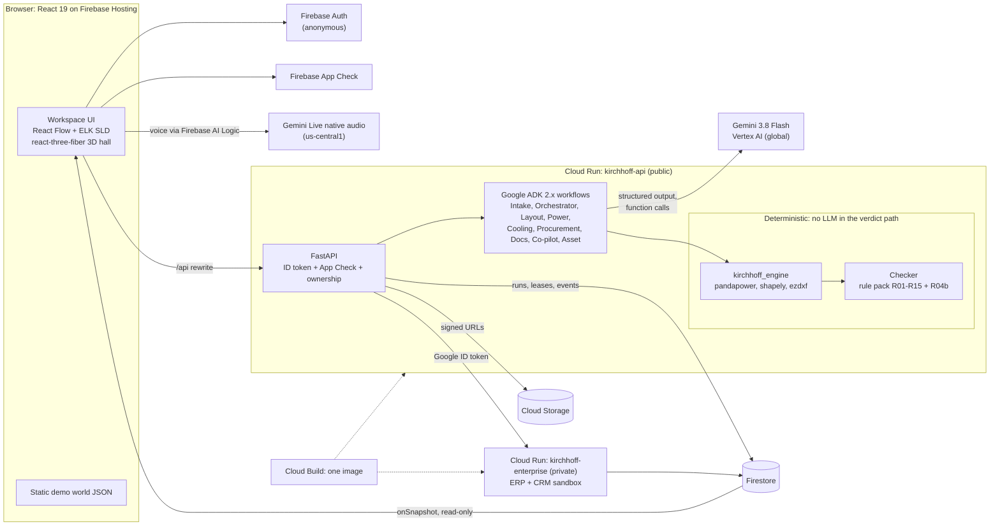

# Kirchhoff

**AI designs. Physics checks. An engineer signs.**

Gemini agents read a tender and design the power and liquid cooling for an AI data hall. A deterministic checker verifies every number against clause-cited rules, and an engineer reviews and signs.

**Live demo:** https://kirchhoff.web.app (no login needed: click "Enter the demo workspace")

<!-- [SHOT: Hero image. Workspace for Hall A (signed): 3D hall all green, agent lanes on the left, co-pilot on the right, revision bar "r1 (2 fail) → r2 ✓ → signed". Save as docs/media/hero.png at 2400 px wide.] -->


> **Fictional data.** Every company, person, project and record in the demo world is fictional. The ERP and CRM are sandboxes (simulated).
>
> **IEC-based, illustrative values, not for construction.** The rule pack and catalogue use illustrative values. Kirchhoff produces checked concept designs, not construction drawings.

Built by team **Ordinal** for the Google Cloud × Hack2skill AI Builder Cup 2026, under the theme *Future of Work & Enterprise Productivity*.

---

## What it does

Start with a tender. Finish with a signed design.

- **Reads the tender.** Gemini reads the tender PDF natively and extracts requirements, each tied to a verbatim quote that we verify on its page. It also flags where the client contradicts itself.
- **Designs power and cooling together.** Agents lay out racks, propose costed redundancy topologies (2N, distributed redundant, block), size the electrical chain, and design the CDUs, hydraulic zones and pipework in one model.
- **Designs around what can ship.** Procurement reads ERP stock and lead times. When equipment can't arrive within the tender's limit, the engine swaps it for a unit that can and re-checks the result.
- **Checks every number.** A deterministic checker runs the rule pack R01–R15 plus R04b. Each finding carries its rule, clause, formula, inputs, value and limit. Agents fix failures using only fixes that the engine has already re-checked.
- **Answers what-ifs.** Change rack power, liquid fraction, the voltage-drop limit or the transformer loading cap, and see every downstream failure as an impact chain across both disciplines. You can ask by text or by voice.
- **Hands off.** An engineer reviews the diff and the assumptions ledger, then signs. Approval raises purchase requisitions in the ERP and moves the CRM opportunity.
- **Extends to other assets.** Thin Grid (132 kV line) and Solar (PV field) packs reuse the same shell and checker.

### The sample hall (measured on 14 Oct 2026)

| | Result |
|---|---|
| Hall | 48 racks × 132 kW, 6 rows of 8, in a 60 × 36 m hall |
| Power | 2N on 2.5 MVA transformers: 47.97% normal / 95.95% N-1 (R01 limits ≤ 80% / ≤ 100%, spec, tender §4.3) |
| Supply chain | ERP: 2.5 MVA has 0 in stock and a 98-week lead time against the tender's 26-week limit (§2.3), so R15 fails. The engine swaps to 3.15 MVA (6 in stock): 38.07% / 76.15%. Fault level rises from 60.45 to 65.42 kA and is re-checked |
| Cooling | 9 CDUs of 1.2 MW |
| First-pass check | 149 findings: 147 pass, 2 fail |
| R05 fail | Feeder FA-01 (82 m): ΔV 2.16% against 2.0%. Fixes: 2,000 A busway (1.66%, +$11,480) or parallel cable (0.84%, +$15,580) |
| R11 fail | Header H-Z2 crosses above feeder FB-03 at y ≈ 24 m. Fixes: local drop (+$420, 1 pipe) or reroute (−$910, 2 pipes) |
| What-if at 200 kW per rack | R01 (113.6%), R02 (2,343 A), R03, R05, R07, R08 (2,560 kW > 2,400 kW) and R09 fail: 60 findings, 18 impact chains, about 8 ms after warm-up |
| Checker benchmark | 35/35 seeded design mutations caught, 0 false positives |
| Determinism | Byte-identical output across Python hash seeds |
| Solar pack | STR-28 recommended: 327 tables, about 5,036 kWp, DC/AC 1.26, clear-sky yield about 2,639 kWh/kWp (clear-sky only) |

---

## Architecture



- **Firebase Hosting** serves the React app and a static demo world, so browsing works even if the backend is down. **Firebase Auth** signs every visitor in anonymously into a private workspace. **App Check** attests every request. **Firebase AI Logic** connects the browser to Gemini Live for voice.
- **Cloud Run `kirchhoff-api`** runs FastAPI, the ADK agents (LlmAgent + function tools) and the engine. It verifies the Firebase ID token, the App Check token and workspace ownership on every call. Runs execute as background phases that hold a Firestore lease with heartbeats. If a worker dies, resume skips finished steps and re-runs the rest.
- **Cloud Run `kirchhoff-enterprise`** is the private ERP and CRM sandbox, built from the same image. Only our dedicated least-privilege service account can invoke it.
- **Firestore** stores run state, leases, the live event stream, revisions, findings, approvals and the sandbox seed. Clients read only their own workspace and never write.
- **Cloud Storage** holds tenders, drawings and exports, served through signed URLs. **Cloud Build** builds the single image.

The Google Cloud brief has more detail: [docs/submission/gcp-brief.md](docs/submission/gcp-brief.md).

---

## How the trust model works

The agents propose. The engine decides. An engineer signs.

1. **Every number on screen comes from the engine.** `kirchhoff_engine` is pure Python with no LLM calls. It computes loading, ampacity, voltage drop, IEC 60909 short circuit (pandapower), N-1 redundancy, coolant hydraulics and spatial clashes (shapely).
2. **The checker has no LLM in it.** The rule pack R01–R15 plus R04b runs deterministically, and each finding cites its clause. Agents never mark their own work.
3. **Citations are verified.** Gemini returns a page, a verbatim quote and a value for each requirement. We accept the requirement only if pdfplumber finds that quote on that page and the quote contains the value.
4. **LLM text can't introduce numbers.** Agent narration, finding explanations and co-pilot answers may contain digits only through placeholders that the engine fills, or through allowlisted ids such as `FA-01`, `R11`, `§4.6` or `2N`. Any other digit replaces the sentence with a template.
5. **Fixes are pre-checked.** The engine offers a fix only after re-running the full rule pack on it. The agent then chooses among the offered fixes on cost and margin, and states its reason.
6. **Assumptions are written down.** Agents log the gaps they fill in an assumptions ledger. The ledger also lists what v0.1 does not check, such as earth-fault loop impedance, selectivity, arc flash and harmonics.
7. **A human signs.** Sign-off always waits for an engineer. The stamp records name, role, time and the SHA-256 hash of the revision.
8. **Output is deterministic.** The same input produces byte-identical output across Python hash seeds.

---

## Demo walkthrough

Open https://kirchhoff.web.app and click **Enter the demo workspace**. The welcome screen offers a short guided tour:

1. **Projects dashboard.** Your (fictional) firm's live projects.
2. **Hall A, signed.** Every number is checked and cited. Open a row in the compliance matrix.
3. **Finding drawer.** Open a finding and click the tender chip; the PDF jumps to the clause.
4. **Agent lanes and run history.** See what each agent did.
5. **What-if.** Set racks to 200 kW and watch the impact chain light up.
6. **Integrations.** Approval pushed purchase requisitions to the ERP and moved the CRM deal.
7. **Hall B.** Run the design live yourself, in Ask mode (you decide at every gate) or Auto, or replay a recorded run.

The demo world contains 60 ERP materials, 9 CRM opportunities and 3 historical purchase requisitions, all fictional. **Reset demo workspace** clears your changes.

<!-- [SHOT: GIF of tour step 3. The finding drawer opens on R11, the tender chip is clicked, and the PDF jumps to §6.3.4. Save as docs/media/finding.gif.] -->
<!-- [SHOT: GIF of tour step 5. The 200 kW what-if lights the impact chain. Save as docs/media/what-if.gif.] -->

---

## Quick start (local development)

Prerequisites: Python 3.12 with [uv](https://docs.astral.sh/uv/), Node.js with npm, and Google Cloud application-default credentials with Vertex AI access (`gcloud auth application-default login`).

```bash
make dev-api   # FastAPI + ADK agents on http://localhost:8080
make dev-web   # React app (Vite dev server)
make test      # API tests (pytest) and web tests
```

The `dev-api` target points at our Google Cloud project. To use your own, change the `GOOGLE_CLOUD_PROJECT` and `GOOGLE_CLOUD_QUOTA_PROJECT` values in the target. See the [Makefile](Makefile) for all targets, including type generation and deployment.

### Repository layout

```
apps/web/              React app (static demo world in public/demo)
services/api/          FastAPI, ADK agents, kirchhoff_engine, rule pack, enterprise sandbox, tests
scenarios/hall_a/      tender PDF, hall drawing, catalogue, ERP/CRM seed, golden-run capture
scenarios/demo_world/  fictional organisation, projects and integrations generators (fixed seed)
infra/                 Firebase config, Firestore and Storage rules, deploy scripts
docs/                  design spec and submission material
```

---

## Tech stack

| Layer | Technology |
|---|---|
| Agents | Gemini 3.8 Flash on Vertex AI (global), Google ADK 2.x multi-agent workflows |
| Voice | Gemini Live native-audio model (us-central1) via Firebase AI Logic; push-to-talk fallback |
| API | Python 3.12, FastAPI on Cloud Run (two services: public API, private enterprise sandbox) |
| Engine | pandapower (IEC 60909 short circuit), shapely (geometry and clashes), ezdxf (DXF), pdfplumber (quote verification) |
| Data | Firestore (run state, leases, live events, sandbox seed), Cloud Storage (documents, signed URLs) |
| Web | React 19, React Flow with ELK (single-line diagram), react-three-fiber (3D hall) |
| Platform | Firebase Hosting, Firebase Auth (anonymous), Firebase App Check, Cloud Build |

---

## Team

**Ordinal**
- **Mehul Arora**, team lead
- **Jayadratha**

We wrote all the code in this repository during the AI Builder Cup 2026 build window.

---

*Fictional data: every company, person and record in the demo is invented. IEC-based, illustrative values, not for construction.*
