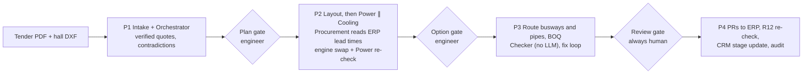
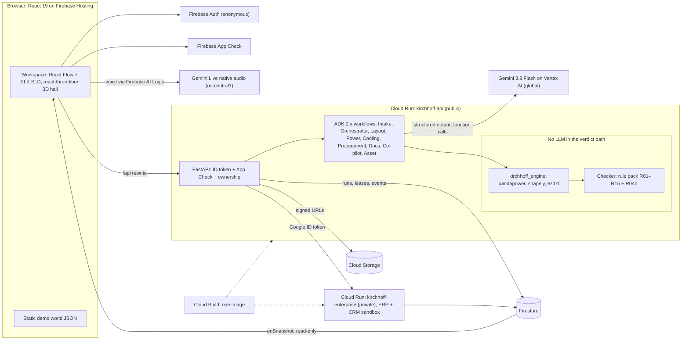

# Kirchhoff: deck content (AI Builder Cup 2026)

Draft for the 16-slide submission template, in the template's order and with its headings. Theme: *Future of Work & Enterprise Productivity*.

**Conventions**
- `[SHOT: …]` marks where a screenshot or clip goes, with the screen and the state to capture. Capture every value from the recorded run; never type a value by hand.
- `(spec)` marks a number taken from the design spec that has not yet been measured on the running product. Verify it or remove the marker before export.
- `[TBD: …]` marks a slot the team must fill.
- Body copy stays at or under about 40 words per slide. The template's own heading and prompt text are not counted.
- Every company, person and record in the demo world is fictional. Engineering values are IEC-based and illustrative, not for construction.
- Market sources are listed at the end of this file. Superscript numbers on slides point to that list; put the short source line in the slide footer.

---

## Slide 1 · Team Details

**On-slide copy**

a. Team name: Ordinal
b. Team leader name: Mehul Arora (with Jayadratha)
c. Problem Statement: AI data halls need power and liquid cooling designed together, around equipment that can actually ship, by senior engineers in short supply. And only 6% of engineers trust AI results without checking.¹

**Speaker notes**

We are Ordinal: Mehul Arora, who leads, and Jayadratha. Our product is Kirchhoff.

The problem has three parts. First, AI halls couple two disciplines that are usually designed apart: the electrical chain and the liquid-cooling loop. Racks now run far denser than older halls; Vertiv's own reference designs span 20 to 142 kW per rack.² Our sample hall runs 132 kW per rack. Second, the supply chain now shapes the design. Transformer lead times are long enough that Hitachi's standardisation push talks about getting them down to "as little as 12 months".³ A design that specifies equipment nobody can deliver is a design you redo. Third, the people who do this work are scarce, and Hitachi's HMAX Energy launch names workforce shortages directly.⁴

AI can draft, but engineers don't trust it, and they are right not to. Only 6% trust AI results without verification and 89% check by hand.¹ When six AI models were asked for one pump station's heating load, they answered anywhere from 25 to 150 MBH.⁵ A general-purpose model reported a voltage drop as 5% when it was 1.76%.⁶ The question has moved from "Should I use AI?" to "How do we control it?"⁷

**Visual**

Template title slide. Put the Kirchhoff wordmark and the line "AI designs. Physics checks. An engineer signs." beside the team block. Footer: ¹ Omni Calculator, AI adoption in engineering.

---

## Slide 2 · DELETE before export (template's download-instructions slide, no heading)

**On-slide copy**

None. This is the template's download instruction slide.

**Speaker notes**

None. Delete this slide before exporting the final PPTX; it carries no content. Leave every other slide in template order.

**Visual**

None.

---

## Slide 3 · Brief about the idea

**On-slide copy**

Start with a tender. Finish with a signed design.

Gemini agents design power and liquid cooling for AI data halls. A deterministic checker proves every number against cited clauses. ERP lead times shape the equipment. An engineer signs off.

**Speaker notes**

Kirchhoff turns weeks of scarce senior-engineer work into one reviewed, signed design session.

Meet Priya, our persona: lead electrical engineer at a data-centre EPC contractor, with a small team and several hall packages due this month. Today she drafts. With Kirchhoff she reviews.

Here is the flow. Gemini agents read the tender, cite every requirement, and flag where the client contradicts itself. They lay out 48 racks of 132 kW in a 60 × 36 m hall, then design the 2N power chain and the liquid-cooling loop together. Procurement reads the ERP, and when a transformer can't ship in time, the engine swaps it for one that can. A deterministic checker, with no LLM in the verdict path, runs the clause-cited rule pack. The agents fix what fails, and the engineer signs. Approval raises purchase requisitions in the ERP and moves the deal in the CRM.

This maps onto the theme. Knowledge: every number links to its tender sentence and its clause. Collaboration: humans and agents share one workspace. Decisions: costed options and what-ifs come before you commit. Workflow: the path runs from tender PDF to signed revision to purchase requisitions to the CRM update. In short, one senior engineer supervises a team of design agents.

**Visual**

[SHOT: Workspace, Hall A (signed). 3D hall all green; agent lanes on the left all ✓; co-pilot on the right; revision bar reads "r1 (2 fail) → r2 ✓ → signed by Priya Raman (Reviewer)".]

Put the tagline lockup above the shot. Footer (small print): "Demo: Priya Raman and all companies, people and data are fictional. IEC-based, illustrative values, not for construction."

---

## Slide 4 · Opportunities

**On-slide copy**

*How different is it from any of the other existing ideas?*
Endra, ArchiLabs and Augmenta generate designs. None publicly shows an independent clause-cited checker, coupled power and liquid cooling, or ERP lead-time-aware design.

*How will it be able to solve the problem?*
Agents draft. Physics verifies. Engineers review.

*USP of the proposed solution*
AI designs. Physics checks. An engineer signs.

**Speaker notes**

The market is moving fast. Endra raised $50M in June 2026, and the press framed the round as data-centre design automation.⁸ Its Power Studio circuits a whole building in about a second (spec, from the team's competitor research). Yet its violation flags are generic, it cites no clauses, it checks itself, and no Endra demo shows busways, CDUs or 2N topologies. ArchiLabs pairs web CAD and agentic chat with data-centre layouts and SLDs, but no public video shows calculation depth.⁹ Augmenta routes conduit, and data centres are its most common project type, but runs take 26 minutes to 12 hours and it doesn't cite the code.¹⁰ ETAP's 2026 copilot runs studies from chat inside a dense desktop app.¹¹

We compete on three things nobody shows publicly:
1. **An independent checker that cites clauses.** The checker is deterministic code, separate from the agents that design, so the AI can't mark its own homework. Every finding carries its rule, its tender clause, its formula and inputs, and its value against its limit.
2. **Power and cooling in one model.** The checker catches coolant piping routed above a live busway feeder, a clash no single-discipline tool sees.
3. **Design around what can ship.** Lead time is a checked rule (R15) fed by ERP data. Speed-to-power needs speed-to-design.

**Visual**

Comparison grid on a light background. Use ✓ for "shown" and a grey "not shown" for everything else; never write "no" about a competitor. Footnote: "Based on public demos and material reviewed 13 Oct 2026."

| | Kirchhoff | Endra Power Studio | ArchiLabs | Augmenta | ETAP 2026 Copilot |
|---|---|---|---|---|---|
| Independent checker, clause-cited findings | ✓ | not shown (generic flags) | not shown | not shown | not shown |
| Power + liquid cooling in one model | ✓ | not shown | not shown | not shown | not shown |
| ERP lead time as a checked rule | ✓ | not shown | not shown | not shown | not shown |
| Data-centre power design | ✓ 2N, DR, block (spec) | not shown | layouts + SLDs | conduit routing | studies from chat |
| Where it runs | browser | browser | browser | inside Revit | desktop |

---

## Slide 5 · List of features offered by the solution

**On-slide copy**

- Tender intake with verified quotes
- Power and liquid cooling, one model
- Clause-cited checker: R01–R15, R04b
- ERP lead-time-aware redesign
- What-if impact chains
- Live voice co-pilot
- Review and sign-off with revision hash
- ERP and CRM handoff
- Grid and Solar asset packs

**Speaker notes**

- **Intake.** Gemini reads the tender PDF natively. A requirement is accepted only if pdfplumber finds its quote on the cited page. Intake also flags contradictions, such as §4.2 "2N" against Appendix B "block or distributed redundancy acceptable". Gemini reads the drawing, and the engine cross-checks it against the DXF.
- **Gates and autonomy.** Each run passes three gates: plan, option and review (spec). In Ask mode the engineer decides at every gate. In Auto, the tender's main clauses decide, but the review gate always waits for a human.
- **Design.** Layout places racks. Power offers three costed topologies: 2N, distributed redundant and block redundant (spec). Cooling sizes CDUs, hydraulic zones and pipes. In the sample hall, the 2N transformers run at 47.97% normal and 95.95% in N-1, against R01's limits of 80% normal and 100% N-1 (spec, tender §4.3). The design uses 9 CDUs of 1.2 MW.
- **Checker.** The checker runs the R01–R15 and R04b rule pack. Each finding shows its rule, clause chip, tender chip, formula, and a value-against-limit bar. The engine offers a fix only after re-running the full rule pack on it, and the owning agent then chooses on cost and margin.
- **Lead-time redesign.** The ERP shows the 2.5 MVA transformer with 0 in stock and a 98-week lead time, against the tender's 26-week limit. The engine swaps to a 3.15 MVA unit, with 6 in stock, and re-checks the fault level.
- **What-if.** Change rack kW, liquid fraction, the ΔV limit or the loading cap. The engine reruns every rule without saving and draws the impact chain across both disciplines.
- **Voice.** Gemini Live can call `what_if`, `explain_finding` and `focus_element`. If Live can't connect, push-to-talk takes over.
- **Review.** The review page shows the diff, the assumptions ledger (including what we don't check), and the findings summary. Approval stamps name, role, time and revision hash.
- **Handoff.** Approval raises purchase requisitions in the ERP sandbox, re-checks that SLD, BOQ and PR lines agree (R12), and moves the CRM opportunity. Exports cover a PDF calc report and a BOQ CSV.
- **Asset packs.** The Grid pack covers a 132 kV line. The Solar pack lays out a PV field. Both reuse the same shell and checker.

**Visual**

Grid of 3 × 3 tiles, each with an icon, the label and a small crop:
[SHOT: Intake lane, "✓ quote verified" cards] · [SHOT: 3D hall, busways and pipes on their tiers] · [SHOT: compliance matrix] · [SHOT: option card showing the R15 swap] · [SHOT: impact chain lit in two colours] · [SHOT: co-pilot voice button with on-screen transcript] · [SHOT: review stamp with hash] · [SHOT: Integrations page] · [SHOT: Solar field layout]

Footer (small print): "All companies, people and data shown are fictional. IEC-based, illustrative values, not for construction."

---

## Slide 6 · Process flow diagram or Use-case diagram

**On-slide copy**

Four phases. Three gates. One signed revision. (spec)

In Ask mode, the engineer decides at every gate. In Auto, the tender's own clauses decide. Sign-off always waits for a human.

**Speaker notes**

A run has four phases (spec).

1. **P1: Intake and Orchestrator.** Agents extract requirements and open questions. At the plan gate the engineer approves the plan, or Auto resolves it: a numbered clause beats an appendix, so the run proceeds as 2N.
2. **P2: design.** Layout places the racks. Power and Cooling then work in parallel. Procurement annotates the options with ERP lead times and applies the deterministic in-stock swap, and Power re-checks the fault level. At the option gate the engineer picks a topology.
3. **P3: route and check.** Layout routes the busways and Cooling routes the pipes. The engine derives the BOQ and draft PR lines, and the checker runs. The owning agents fix what fails, for at most 2 iterations (spec), and the checker re-runs after each. The run stops at the review gate, which is always human.
4. **P4: handoff.** On approval, PRs go to the ERP, R12 re-checks them against the SLD and BOQ, the CRM stage moves, and an audit entry is written.

Each phase runs in the background on Cloud Run and streams through Firestore, so you watch the agents work live.

**Visual**

Swimlane diagram with four lanes: **Engineer** · **Gemini agents (ADK)** · **Deterministic engine + checker (no LLM)** · **ERP / CRM sandbox**. Show the gates as diamonds in the Engineer lane. Designer version:

---

## Slide 7 · Wireframes/Mock diagrams of the proposed solution (optional)

**On-slide copy**

Trust, built into the screen.

- Every number comes from the engine.
- Every requirement quote is found on its PDF page.
- AI text can't carry its own digits.
- Every sign-off stamps a revision hash.

**Speaker notes**

This slide shows our trust model as the engineer sees it.

- **Numbers.** Every number on screen comes from the engine, which is pure Python with no LLM calls.
- **Citations.** Gemini returns a page, a verbatim quote and a value. We accept the requirement only if pdfplumber finds that quote on that page and the quote contains the value. Clicking the chip opens the PDF at the highlighted box.
- **Digit filter.** LLM text may contain digits only through placeholders that the engine fills, or through allowlisted ids such as FA-01, R11, §4.6 or 2N. Any other digit replaces the sentence with a template. A model can't invent a number on our screen.
- **Ledger.** Agents log the assumptions they make, and the ledger also lists what v0.1 does not check: earth-fault loop impedance, selectivity, arc flash and harmonics, for example.
- **Accountability.** An agent can't be held accountable, so only the engineer approves, and the stamp records name, role, time and the SHA-256 revision hash.

**Visual**

Left: the workspace wireframe from spec §12. Header bar with project, Ask/Auto switch and "Request sign-off". Agent lanes on the left; canvas tabs 3D / SLD / Matrix / Options / Docs in the centre; co-pilot on the right; revision timeline along the bottom.

Right: an annotated finding-drawer mock, with callouts on (1) rule id, (2) clause chip and tender chip, (3) formula with inputs, (4) value-against-limit bar, (5) chosen fix and rejected alternative with deltas, (6) "show on canvas".

[SHOT: Finding drawer open on R05 for FA-01: 82 m feeder, ΔV 2.16% against the 2.0% limit, §4.6 chip; fix options "2,000 A busway · 1.66% · +$11,480" and "parallel cable · 0.84% · +$15,580".]

Footer (small print): "IEC-based, illustrative values, not for construction. Demo data is fictional."

---

## Slide 8 · Architecture diagram of the proposed solution

**On-slide copy**

Gemini proposes. The engine decides.

ADK agents run on Cloud Run with Gemini 3.8 Flash. The engine and checker are plain Python with no LLM. Firestore streams every step live; Firebase serves, signs in and attests.

**Speaker notes**

Read it left to right.

- **Browser.** A React 19 app runs on Firebase Hosting. The demo world is static JSON, so browsing works even with the backend down. Anonymous Firebase Auth gives each visitor a private workspace, and App Check attests the app. The client reads Firestore through live listeners and never writes to it. Voice goes through Firebase AI Logic to the Gemini Live native-audio model in us-central1, and its tool calls come back to our API.
- **`kirchhoff-api` on Cloud Run (public, behind the Hosting rewrite).** FastAPI verifies the Firebase ID token, the App Check token and workspace ownership on every call. ADK 2.x workflows run the agents on Gemini 3.8 Flash through Vertex AI (global), with structured outputs and function calling. The tools call `kirchhoff_engine`, which uses pandapower for IEC 60909 short circuit, shapely for geometry and ezdxf for drawings, plus the rule pack. That box is the trust boundary: no LLM inside.
- **Firestore** holds run state, leases, the live event stream, revisions, findings, approvals and the sandbox seed. **Cloud Storage** holds tenders, drawings and exports, served through signed URLs.
- **`kirchhoff-enterprise` on Cloud Run (private).** The ERP and CRM sandbox runs from the same image. Only our dedicated, least-privilege service account can invoke it, using a Google ID token.
- **Cloud Build** builds one image that deploys as both services.

We chose Cloud Run over a managed agent runtime because the engine needs native scientific Python and runs execute as long background phases.

**Visual**

Diagram, held as a full slide. Draw the deterministic zone as a dashed red box labelled "No LLM in the verdict path".

---

## Slide 9 · Technologies to be used in the solution

**On-slide copy**

**AI:** Gemini 3.8 Flash on Vertex AI · Gemini Live · Google ADK 2.x
**Google Cloud:** Cloud Run · Firestore · Cloud Storage · Cloud Build
**Firebase:** Hosting · Auth · App Check · AI Logic
**Engine:** FastAPI · pandapower · shapely · ezdxf
**Interface:** React 19 · React Flow + ELK · react-three-fiber

**Speaker notes**

Every Google service in this list carries load.

- Gemini does the reading, the citations, the planning, the choices with reasons, the explanations and the voice.
- ADK agents call engine tools; the run orchestrator orders the phases, the gates and the fix loop.
- Cloud Run hosts the agent and engine API and the private enterprise sandbox.
- Firestore is the live event bus and the audit trail.
- Firebase serves the app, gives every visitor an anonymous workspace, attests requests with App Check, and connects the browser to Gemini Live.

The engine stands on open-source physics. pandapower runs IEC 60909 short circuit, shapely handles clash and clearance geometry, ezdxf reads the hall DXF, and pdfplumber verifies quotes. The interface uses React Flow with ELK layout for the single-line diagram and react-three-fiber for the 3D hall.

**Visual**

A logo wall in the ArchiLabs integrations style: light background, monochrome logos in five labelled rows matching the copy. Put Google logos first and keep their official marks.

---

## Slide 10 · Estimated implementation cost (optional)

**On-slide copy**

**Run cost**
- 1 warm Cloud Run instance (spec)
- USD 200 budget with alerts (spec)
- Gemini 3.8 Flash: $0.75 / $3.75 per 1M tokens¹²
- Per design: [TBD: measured USD per run]

**How we charge**
Seats for design teams; enterprise tier adds ERP/CRM connectors.

**Speaker notes**

**Cost.** The prototype runs on one warm API instance with no CPU throttling, scaling to a maximum of 3 (spec). The enterprise sandbox is a second small service. Gemini 3.8 Flash costs $0.75 per million input tokens and $3.75 per million output tokens through 31 December 2026, and the price doubles from 1 January 2027.¹² The engine does the heavy work without tokens. A what-if runs in about 8 ms and makes no LLM call. Budget alerts fire at 50% and 90% (spec). [TBD: Gemini tokens and USD per full run, measured from the recorded run (spec §4, metric 4).]

**Business model (proposed).** We sell to data-centre EPC contractors and design consultancies, where the buyer is the engineering lead whose senior hours are the bottleneck. Design teams pay per seat. The enterprise tier adds real ERP and CRM connectors on the same API contract our sandbox uses today, and later an on-prem model option. We start with design partners before setting public prices.

**Enterprise integration.** Kirchhoff already talks to an ERP and a CRM through APIs: a separate private Cloud Run service seeded with 60 materials, 9 CRM opportunities and 3 historical PRs. Approval raises purchase requisitions, re-checks them against the SLD and BOQ, and moves the opportunity to "Design approved". Swapping the sandbox for SAP or Salesforce changes the adapter, not the workflow.

**Visual**

Two columns: "Run cost" on the left and "How we charge" on the right. Add a small strip showing the integration path: Kirchhoff → `/api/enterprise` → ERP (SAP-style) / CRM (Salesforce-style), labelled "sandbox (simulated) today; real connectors on the roadmap".

---

## Slide 11 · Snapshots of the prototype

**On-slide copy**

1. Your firm's projects, already in motion
2. Agents design in parallel
3. Every finding cites its clause
4. 98 weeks → ships from stock
5. 200 kW per rack: 18 impact chains
6. Signed, with a revision hash

**Speaker notes**

These come from the live product at kirchhoff.web.app. Every company and person in the demo world is fictional.

1. The projects dashboard for Meridian Power Engineering, a fictional EPC firm, with data-hall, grid and solar projects in different states.
2. Agent lanes during a live Hall B run. The footage is time-compressed and carries an elapsed-time clock.
3. The finding drawer for R11. Header H-Z2 runs above feeder FB-03 at y ≈ 24 m, breaking tender §6.3.4. The engine offers two verified fixes: a local drop (+$420, 1 pipe changed) or a reroute (−$910, 2 pipes changed).
4. Option cards after the R15 swap. The 2.5 MVA unit has 0 in stock and a 98-week lead time, so the engine picks the 3.15 MVA unit, with 6 in stock, which runs at 38.07% normal and 76.15% in N-1. The fault level moves from 60.45 to 65.42 kA and is re-checked.
5. The what-if at 200 kW per rack. R01 fails at 113.6%, R02 at 2,343 A, and R08 at 2,560 kW against 2,400 kW; R03, R05, R07 and R09 also fail. That is 60 findings in 18 impact chains.
6. The review page with the diff, the assumptions ledger and the approval stamp.

**Visual**

A 3 × 2 grid, one caption under each:
1. [SHOT: Projects dashboard. Hall A "Signed", Hall B "Not started", Grid and Solar cards; fictional-data banner visible.]
2. [SHOT: Workspace during the Hall B live run (Auto mode, t=150 s). Power and Cooling lanes both Working; elapsed-time clock; the 3D hall drawn from the first revision with its two findings.]
3. [SHOT: 3D hall, R11 finding drawer open. H-Z2 red where it crosses FB-03; §6.3.4 clause chip; both fix options with cost deltas.]
4. [SHOT: Options tab, 2N card Selected, with its swap line "TX-2500 → TX-3150 (R15, line transformer)", loading 38.07% / 76.15% and max lead time 14 weeks. The card does not show the stock count or the 98 wk against 26 wk comparison.]
5. [SHOT: What-if at 200 kW per rack. Impact chain lit rack → busway → board → transformer (power colour) and rack → zone → CDU (cooling colour); counters "60 findings · 18 impact chains".]
6. [SHOT: Review page after approval, of the recorded Hall A run. Diff, ledger with its "not checked" list, stamp "Priya Raman · Lead Electrical Engineer (Reviewer) · time · revision hash" (a live approval would read "You (Demo Reviewer)").]

Footer (small print): "All companies, people and data shown are fictional. IEC-based, illustrative values, not for construction."

---

## Slide 12 · Prototype Performance report/Benchmarking

**On-slide copy**

- **35/35** seeded design faults caught, **0** false positives
- **149** first-pass checks: 147 pass, 2 fail, both fixed
- **~8 ms** per what-if after warm-up
- **Byte-identical** output across Python hash seeds
- **Estimate:** ~10 engineer-hours saved per change iteration (basis in notes)

**Speaker notes**

**What we measured on 14 Oct.**
- **Checker benchmark.** We seeded 35 mutations into the design, covering the rule pack. The checker caught all 35, with zero false positives.
- **First pass on the golden 2N design.** It produced 149 findings: 147 pass and 2 fail. Feeder FA-01 (82 m) drops 2.16% against the 2.0% limit (R05). The fixes are a 2,000 A busway (1.66%, +$11,480) or a parallel cable (0.84%, +$15,580). Header H-Z2 runs above FB-03 (R11). The fixes are a local drop (+$420) or a reroute (−$910).
- **What-if at 200 kW per rack.** Seven rules fail, producing 60 findings in 18 impact chains, in about 8 ms after warm-up.
- **Determinism.** Output is byte-identical across Python hash seeds, so the same design always gives the same verdict.
- **Business result in the sandbox.** A 98-week transformer becomes a 3.15 MVA unit shipped from stock, at 38.07% / 76.15% loading.

**Impact estimate, labelled as an estimate.** We estimate about 10 engineer-hours saved per design-change iteration. The basis is the industry's own figure for reworking a design change by hand: "10+ hours", from Endra's September 2026 launch demo.¹³ That figure is unaudited and comes from commercial buildings.¹⁴ Kirchhoff re-checks every rule in milliseconds, and the engineer's time goes to review rather than recalculation. We found no published figure for how long a first coordinated electrical package takes, so we don't quote one. Kirchhoff produces a checked concept design, not construction drawings, so the honest comparison is first checked concept against first concept. [TBD: measured time from upload to a checker-clean revision, median of 5 live runs, excluding time at human gates (spec §4, metric 1).] [TBD: intake accuracy against our ground truth (spec §4, metric 2).]

**Visual**

Four large stat tiles (35/35 · 149 · ~8 ms · byte-identical) and one smaller estimate tile marked "estimate". Monospace numerals. Below the tiles:

[SHOT: Compliance matrix at the end of the first pass. Counter "149 checks · 147 pass · 2 fail" with the two red cells (R05 FA-01, R11 H-Z2).]

Footer (small print): "IEC-based, illustrative values, not for construction."

---

## Slide 13 · Additional Details/Future Development (if any)

**On-slide copy**

**Now:** AI data hall, plus thin Grid (132 kV line) and Solar packs on the same engine.
**Next:** real SAP and Salesforce connectors, Revit/IFC round-trip, PLM, 800 VDC architectures, on-prem Gemma.
**Smart engineering:** one thread from tender to procurement.

**Speaker notes**

**Asset packs today.** Both packs reuse the shell, the checker and the finding drawer, run by one Asset agent.
- **Grid.** A 132 kV double-circuit line of about 18 km (spec) to the campus substation. It compares three ACSR conductors (spec) on ampacity, voltage regulation and I²R losses, and computes the fault level at the connection.
- **Solar.** A ground-mount field next to the hall. The engine recommends string option STR-28: 327 tables, about 5,036 kWp, DC/AC ratio 1.26. Its clear-sky yield is about 2,639 kWh/kWp, a clear-sky figure only, with no weather losses.

**Roadmap.** We cut these from the hackathon build, and they come next: real ERP and CRM connectors, Revit/IFC round-trip, PLM integration, 800 VDC architectures, auto-layout from messy drawings, Gemma on-prem, live multi-user presence, and drawing render review.

**Smart engineering (Hitachi-relevant).** Hitachi's Smart Engineering track asks for solutions that "connect engineering data across the product lifecycle, automate the processing of legacy documents and requirements, and speed up design with AI agents".¹⁵ Kirchhoff already links tender clauses to design, checks, purchase requisitions and CRM in one audited thread. Hitachi Energy is designing an 800 VDC grid-to-rack system with NVIDIA.¹⁶ An 800 VDC topology pack and the Grid pack extend that thread from the substation to the rack.

**Visual**

A three-column roadmap (Now · Next · Smart engineering) on a light background.
[SHOT: Grid pack. The 132 kV route drawn as a line (drawn geometry, not a basemap), the conductor comparison table, mini SLD.]
[SHOT: Solar pack. Field layout with tables; card "STR-28 recommended · 327 tables · ~5,036 kWp · DC/AC 1.26 · clear-sky yield ~2,639 kWh/kWp (clear-sky only)".]

Footer (small print): "IEC-based, illustrative values, not for construction. Demo data is fictional."

---

## Slide 14 · Provide links to your:

**On-slide copy**

- GitHub Public Repository: [TBD: https://github.com/<org>/kirchhoff]
- Demo Video Link (3 Minutes): [TBD: video URL] (runs 2:45)
- Final Product Link: https://kirchhoff.web.app (no login: "Enter the demo workspace" opens the guided tour)

**Speaker notes**

The live URL opens on a landing page with one primary button. The welcome screen offers a short guided tour. To see a live run, open Hall B and choose "Run it live", or replay a recorded run. The repository README has the architecture, the trust model and the local quick start.

**Visual**

Three rows, each with an icon and a QR code (GitHub, video, live app). Put the URL in large monospace.

---

## Slide 15 · (blank template slide: Team)

**On-slide copy**

**Team Ordinal**
- Mehul Arora, team lead. [TBD: role and one-line background]
- Jayadratha. [TBD: role and one-line background]

Built in JAPAC, for engineering teams everywhere.

**Speaker notes**

[TBD: two sentences per person on what each of us built and the background that makes us credible here.] We built Kirchhoff from scratch during the hackathon window, on Google Cloud end to end.

**Visual**

[TEAM PHOTO SLOT: headshots of Mehul Arora and Jayadratha, supplied by the team.] Under the photos, add a small strip: "Theme: Future of Work & Enterprise Productivity".

---

## Slide 16 · Thank you

**On-slide copy**

Kirchhoff by Ordinal
AI designs. Physics checks. An engineer signs.
kirchhoff.web.app

**Speaker notes**

Thank you. Try it at kirchhoff.web.app; there's no login, and a guided tour walks you through it.

**Visual**

Template closing slide. Put the copy beside "Thank you" in white.

---

## Sources (market context, from our research report of 13 Oct 2026)

1. Omni Calculator, *AI adoption in engineering*: 6% trust AI results without verification; 89% check by hand. https://www.omnicalculator.com/reports/ai-adoption-in-engineering
2. Vertiv AI Hub reference designs, 20–142 kW per rack. https://www.vertiv.com/en-in/solutions/ai-hub/design/
3. Latitude Media, *How Hitachi became a speed-to-power company*: lead times to "as little as 12 months". https://www.latitudemedia.com/news/how-hitachi-became-a-speed-to-power-company/
4. Hitachi, HMAX Energy launch, "workforce shortages". https://www.hitachi.com/en/press/articles/2026/03/0324b/
5. Consulting-Specifying Engineer: six AI models, 25–150 MBH for one pump station. https://www.csemag.com/see-how-ai-can-transform-mep-design-decisions/
6. ELEK, *AI cable sizing*: voltage drop reported as 5% when it was 1.76%. https://elek.com/articles/ai-cable-sizing/
7. AEC Magazine, NXT BLD 2026. https://aecmag.com/nxt-bld/nxt-bld-2026-one-direction-of-travel
8. Ventureburn, *Endra raises $50M to automate data-centre design*. https://ventureburn.com/endra-raises-50m-to-automate-data-centre-design/
9. ArchiLabs. https://archilabs.ai/home
10. Augmenta webinar. https://www.youtube.com/watch?v=3TSAfPRZC_M
11. ETAP 2026 release. https://etap.com/product-releases/etap-2026-release
12. Gemini API pricing: $0.75 in / $3.75 out per million tokens through 31 Dec 2026, doubling from 1 Jan 2027. https://ai.google.dev/gemini-api/docs/pricing
13. Endra Epoch launch demo, scoreboard at 20:00: a change "10+ hours to 10 minutes". https://www.youtube.com/watch?v=oDuVIt6SBJI&t=1200
14. Bricks & Bytes calls Endra's speed claims "directional rather than audited". https://bricks-bytes.com/ai/andreessen-horowitz-just-put-50m-into-endra/
15. Hitachi Startup Challenge 2026, Smart Engineering. https://www.hitachi.com/en-eu/about/events/hitachi-startup-challenge-2026/
16. Hitachi Energy at CERAWeek 2026, 800 VDC with NVIDIA. https://www.hitachienergy.com/news-and-events/press-releases/2026/03/hitachi-at-ceraweek-2026

---

## Open items

Everything below is a `[TBD]` (or team-photo) slot only the team can fill. Nothing else in this file should carry a `[TBD]`.

- **Slide 10 (Estimated implementation cost):** measured USD per design run (on-slide bullet); Gemini tokens and USD per full run, measured from the recorded run (spec §4, metric 4) (speaker notes).
- **Slide 12 (Prototype Performance report):** measured time from upload to a checker-clean revision, median of 5 live runs, excluding time at human gates (spec §4, metric 1); intake accuracy against our ground truth (spec §4, metric 2).
- **Slide 14 (Provide links to your):** GitHub public repository URL; demo video URL.
- **Slide 15 (Team):** Mehul Arora's role and one-line background; Jayadratha's role and one-line background; two sentences per person on what each built and the credibility background (speaker notes); team photo (headshots of Mehul Arora and Jayadratha).

- Re-check every quoted number against the DEPLOYED Hall A bundle after the golden capture (P4 Task 14). The 200 kW what-if count changed from 62 to 60 once the signed revision used the R23 fix choice (parallel cable on FA-01).
